# Driver app mockups

Review these before any screen is built. Open `driver-ui-mockups.html` in a browser and use the bar at the top to switch boards. Add `?bare=1` to hide that bar. Each phone is 390 px wide. The pictures below are the same boards at double resolution.

These were drawn before the phone audit of the current app, because the new screens were asked for first. The audit is still Phase 0 of the plan and has not been run.

Sinhala on the boards is the draft in the plan. A native speaker chosen by the client needs to review it before release.

## SignIn

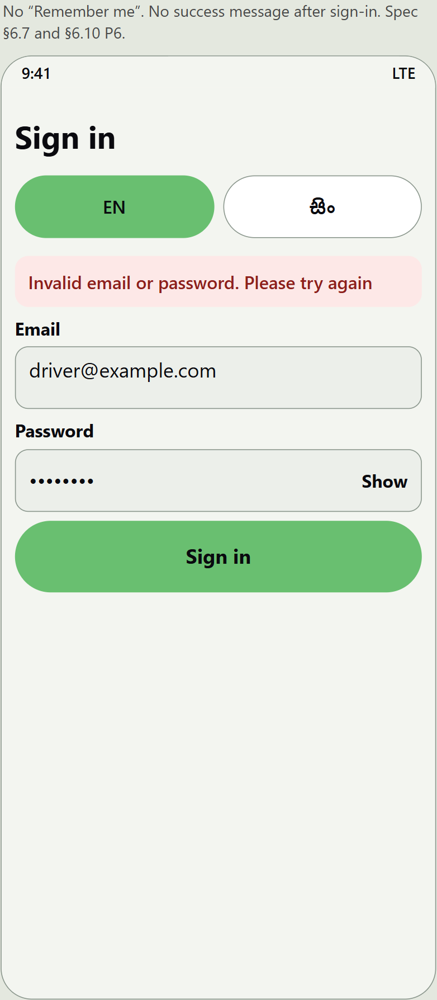

Sign in, with the language switch and an error. There is no “Remember me” and no success message. Spec §6.7 and §6.10 P6.

## Areas-1area

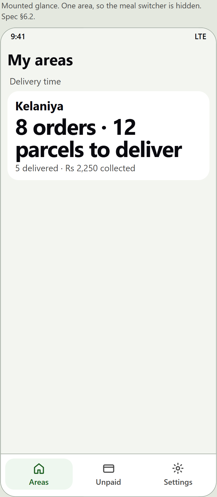

The screen on the handlebar when the driver holds one area. The meal switcher is hidden. The order and parcel counts are the large type. Spec §6.2.

## Areas-3areas

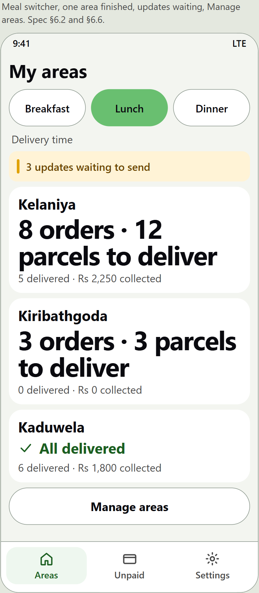

Breakfast, lunch and dinner, one area already finished, and a line when the phone is holding updates that have not been sent. Manage areas sits under the list. Spec §6.2 and §6.6.

## Areas-states

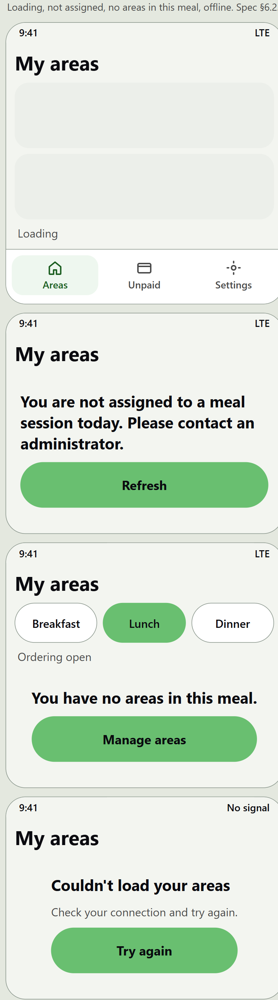

Loading, not assigned today, no areas in this meal, and no connection. Spec §6.2.

## Stops-hostel

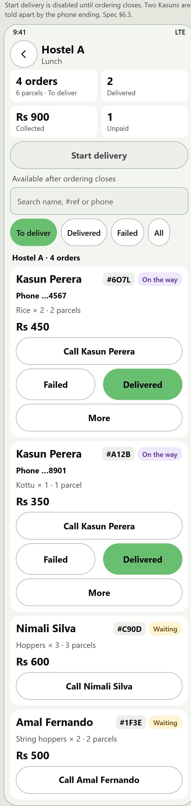

One hostel, four orders. The two customers named Kasun are told apart by the last four digits of the phone number. Start delivery stays off until ordering closes. Spec §6.3.

## Stops-house

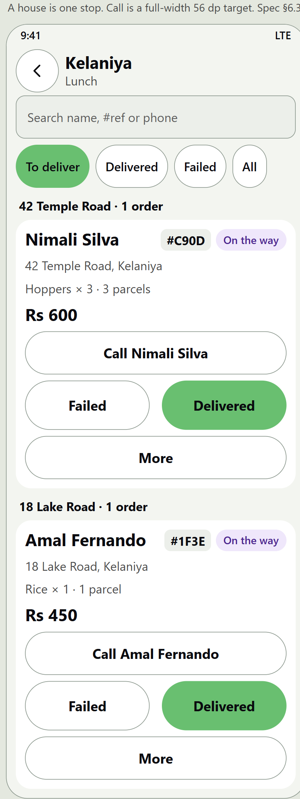

A house is one stop. Call is a full-width button, and Delivered stays the green action. Spec §6.3.

## Card-states

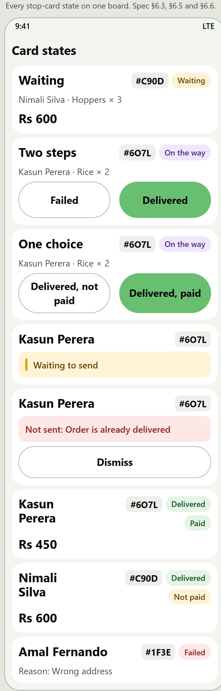

Waiting, on the way with two steps, on the way with one choice, waiting to send, refused, delivered and paid, delivered and not paid, and failed with a reason. Spec §6.3, §6.5 and §6.6.

## Handover-twostep

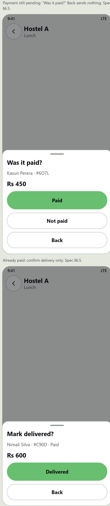

The default handover. If the customer has not paid, the sheet asks “Was it paid?”. If they have already paid, it only asks to confirm delivery. Back sends nothing. Spec §6.5.

## Handover-onetap

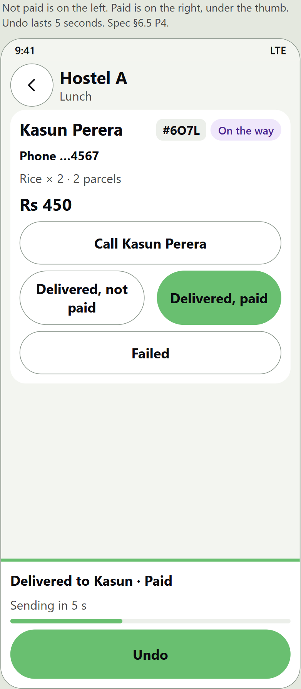

The other handover, chosen in Settings. “Delivered, not paid” is on the left. “Delivered, paid” is on the right. The card and the Undo bar are drawn together so both can be reviewed. After a real tap, the card leaves “To deliver” and the bar shows for 5 seconds. Spec §6.5.

## Failed

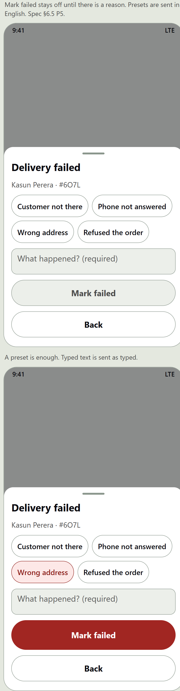

Mark failed stays off until a reason is chosen or typed. The four presets are sent to the server in English. Typed text is sent as typed. Spec §6.5.

## More

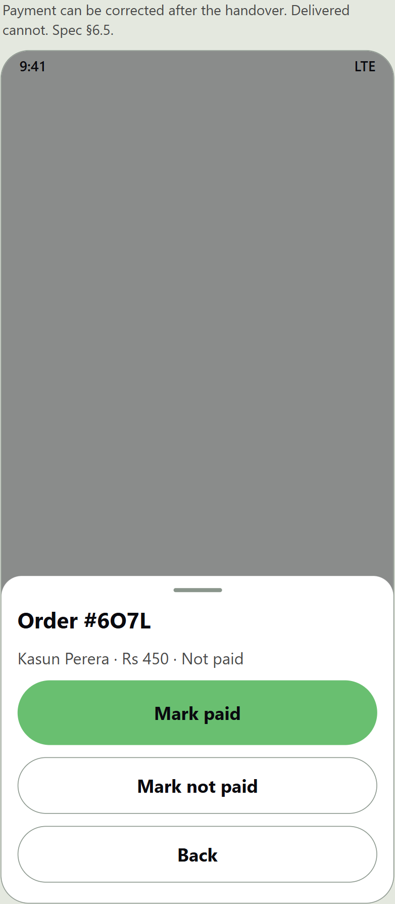

Payment can be corrected after the handover. Delivered and failed cannot, once the server has accepted them. Spec §6.5.

## Unpaid

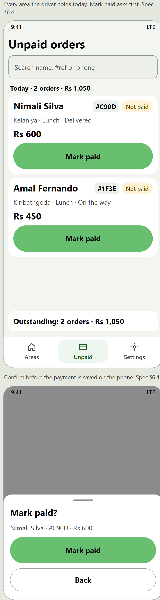

Unpaid orders from every area held today, with the day’s total and the outstanding line. Mark paid asks for a confirmation first. Spec §6.4.

## Settings

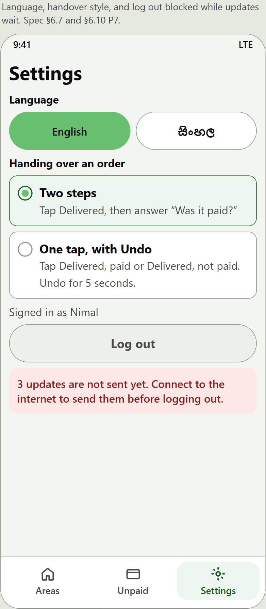

Language, the two handover styles, and log out blocked while updates are still on the phone. Spec §6.7 and §6.10 P7.

## ManageAreas

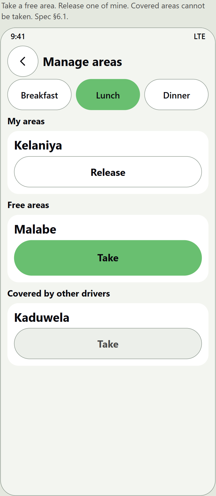

Release an area the driver holds, take a free one, and leave covered areas alone. Spec §6.1.

## TabBar

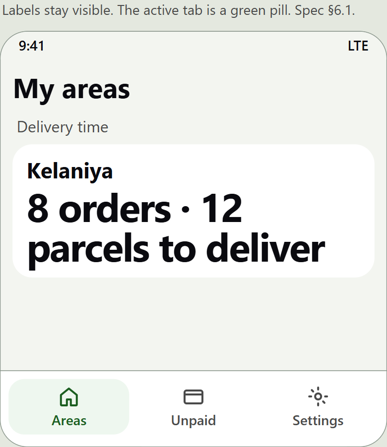

Areas, Unpaid and Settings. The label stays visible, and the active tab is a green pill. Spec §6.1.

## Sinhala

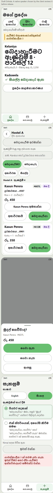

The areas screen, a hostel stop, the “Was it paid?” sheet, and Settings, in the draft Sinhala. Spec §6.7.

## Decisions to confirm

| # | Decision | Default, shown here | Alternative |
|---|---|---|---|
| P1 | Font | The phone’s own font for English and Sinhala | Nunito for English, plus Noto Sans Sinhala |
| P2 | Short reference | Last 4 letters or digits, shown as #6O7L | A number issued by the server |
| P3 | Keep the screen awake | Areas and Stops stay awake while open. This has no picture. | Never |
| P4 | Undo | 5 seconds on the one-tap handover | 3 or 8 seconds |
| P5 | Failure reasons | The four presets, sent in English, plus a text box | A text box only |
| P6 | Sign in | No success message, no “Remember me”, language switch added | Leave sign-in as it is today |
| P7 | Log out | Blocked while updates are waiting on the phone | Allow log out and discard the updates |

## Not in the mockups

- The “Start delivery?” confirmation. The stops board shows the button turned off, with the caption “Available after ordering closes”. The confirmation itself uses the wording already in the plan.
- Pull to refresh, and the light buzz when an action is saved.
- Keeping the screen awake. It does not change the layout.
- Sinhala for Sign in, Unpaid, Manage areas, Failed and More. The Sinhala board covers Areas, Stops, the handover sheet and Settings, which is the set named in the plan.
- The kitchen printing the same #reference. That is a follow-up in the Admin app, written up in `docs/client-notes/2026-10-29-kitchen-parcel-labels.md`.
